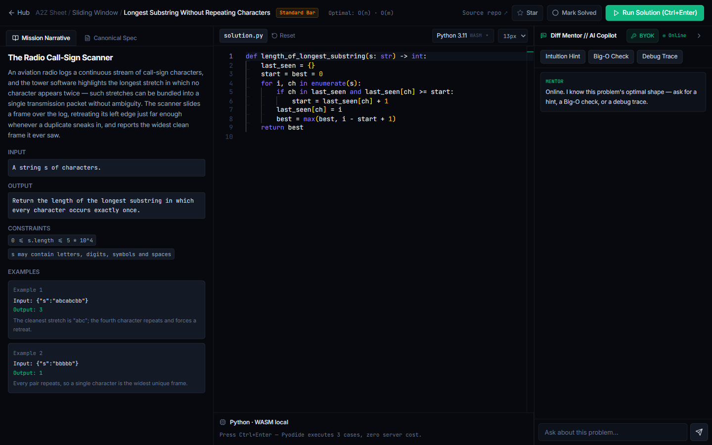
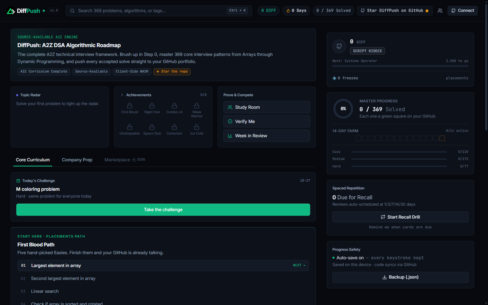
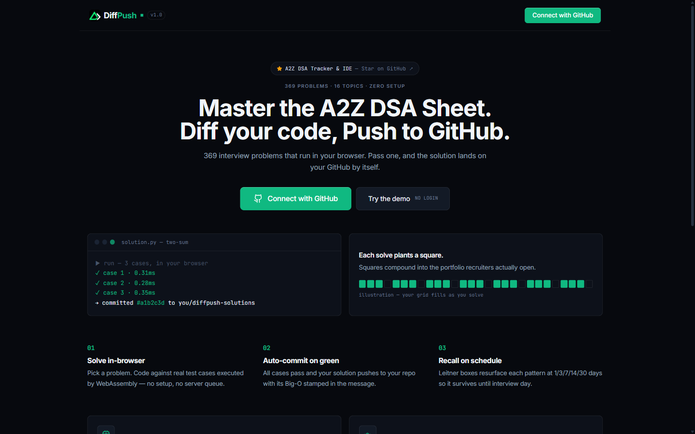

<div align="center">

# DiffPush

**An interactive A2Z DSA workspace: 369 problems that run in your browser and auto-commit accepted solutions to your GitHub.**

[](LICENSE.md)
[](https://pages.cloudflare.com/)
[](CONTRIBUTING.md)

[Live App](https://diffpush.pages.dev) • [Problem pages](https://diffpush.pages.dev/p/largest-element-in-array/) • [Report Issue](https://github.com/dushyanth96/DiffPush/issues) • [Contribute](CONTRIBUTING.md)

</div>

---



## Overview

DiffPush is a local-first interview prep cockpit. It tracks the full A2Z DSA sheet, runs your code in the browser with WebAssembly, and turns every accepted solution into a real GitHub commit — so practice builds a public portfolio instead of a private streak counter.

- **369 curated problems** across 16 topics and three difficulty levels, with narratives, constraints, and public examples.
- **In-browser execution** with Pyodide (Python) and a Web Worker (JavaScript). No server queue, no per-run cost.
- **Automatic GitHub sync** — one OAuth connection, then accepted solutions, complexity notes, and a progress tracker land in your repo.
- **Leitner spaced repetition** with recall cards, streaks, freeze days, and a daily challenge.
- **Zero-database rooms** for pair solving with a live roster, chat, and per-room leaderboards.

## Screenshots

| Dashboard | Landing |
| --- | --- |
|  |  |

## How it works

1. Pick a problem from the curriculum. The workspace loads the narrative, starter code, and test cases.
2. **Run** executes your code locally: Python in Pyodide, JavaScript in a dedicated worker. Results are compared case by case.
3. Design problems (Min Stack, LRU Cache, streams) are dispatched through three entrypoint models: ops replay, constructor repeat, and single-call.
4. On a full pass, DiffPush pushes the solution file and merged tracker state to `diffpush-solutions` on your account, then refreshes your profile README.
5. Solved problems enter the recall queue. Box 3 items resurface after 7 days, not 7 minutes.

## Tech stack

| Layer | Choice |
| --- | --- |
| Frontend | React 18, Vite, Tailwind CSS, Monaco Editor, lucide-react |
| Execution | Pyodide (WASM), Web Workers |
| Static SEO | Prerendered pages for all 369 problems (`dist/p/<slug>/`), sitemap, JSON-LD |
| Backend | FastAPI, httpx, SQLite for rooms, in-process rate limiting |
| Hosting | Cloudflare Pages (SPA fallback) + a single-origin FastAPI service |

## Repository layout

```
curriculum/              Source problem JSON (narratives, tests, starters)
frontend/                React app
  public/problems/       Generated problem corpus (npm run build:manifest)
  src/components/        Marketing, dashboard, workspace, rooms, ads
  src/workers/           Pyodide and JavaScript execution harnesses
backend/                 FastAPI API (auth, sync, rooms, BYOK chat)
scripts/                 Manifest generation + per-problem prerender/sitemap
docs/                    Screenshots and supporting assets
```

## Getting started

### Frontend

```bash
cd frontend
npm install
npm run dev          # http://localhost:5173
```

Optional: point the app at a non-local API with `VITE_API_URL` (defaults to `http://localhost:8000`).

```bash
npm run build        # vite build + 369 prerendered problem pages + sitemap.xml
npm run build:manifest   # regenerate public/problems + manifest from curriculum/
```

### Backend (optional — needed for GitHub sync, rooms, and AI coach)

```bash
cd backend
python -m venv .venv
# Windows: .venv\Scripts\activate    macOS/Linux: source .venv/bin/activate
pip install -r requirements.txt
copy .env.example .env   # fill GITHUB_CLIENT_ID / GITHUB_CLIENT_SECRET
uvicorn app.main:app --reload --port 8000
```

The frontend works without the backend in guest mode: progress stays local, and GitHub pushes are queued until a token exists.

### Checks

```bash
cd backend
python verify_sync.py     # GitHub merge/commit flow + error mapping
python verify_chat.py     # BYOK proxy, key redaction, throttling
python verify_rooms.py    # presence, messages, pruning
python verify_harness.py  # execution harness + dispatch coverage for all 369 problems
```

## Privacy and ads

Progress, drafts, and your GitHub token stay in the browser. The backend forwards the token only for profile, commit, and room calls; the AI coach is bring-your-own-key and never stores keys.

Free access is supported by third-party ad units (Mondiad and A-ADS). Ads are never required: blockers don't remove features. Limited aggregate analytics use Umami without cookies or a cross-site profile. Details: [Privacy](https://diffpush.pages.dev/privacy).

## License and commercial terms

DiffPush is **source-available** under the [PolyForm Noncommercial License 1.0.0](LICENSE.md). It is not OSI "open source" because commercial use is restricted.

- **Free forever** for students, hobbyists, research, and non-commercial study — including forks, local modification, and self-hosting.
- **Commercial use** (paid access, ad-supported redistribution, or a monetized hosted fork) requires prior written authorization and a baseline 10% gross-revenue royalty agreement.
- For licensing: dushyanthpragada9@gmail.com

## Contributing

Bug reports, problem corrections, and UI fixes are welcome. Read [CONTRIBUTING.md](CONTRIBUTING.md), keep changes scoped, and run the checks above before opening a PR. Please don't add additional tracking scripts or new ad networks.
